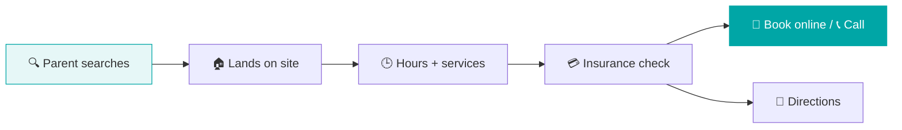

# 🩺 Instant Pediatric Care

### Expert pediatric care, one tap from any parent's phone.

A family-friendly WordPress website for **Instant Pediatric Urgent Care** in Plano, Texas. Parents can quickly reach expert care, book appointments and find clinic details, all in one smooth, comforting online experience.

---

## ⚡ The problem → the fix

> A parent with a feverish child at 7 PM doesn't want to read. They need to know: **Are you open? Do you take my insurance? Where are you?**

The site answers all three above the fold, then makes the next step one tap: **walk in, book online, call or get directions.**

---

## ✨ Key features

| | Feature | Why it matters |
|:-:|---|---|
| 🧸 | **Warm, welcoming design** | Tailored for families, so a stressful visit starts calmly |
| 📅 | **Easy appointment & contact** | Book a visit or reach the clinic in a couple of taps |
| 🚑 | **Urgent care services up front** | Children's urgent care services highlighted where parents look first |
| 🧭 | **Clear location & directions** | Get to the clinic fast, with map and parking info |
| 📱 | **Works on every screen** | Smooth on phones, tablets and computers |

---

## 🗂️ What's on the site

| | Section | What it does |
|:-:|---|---|
| 🕒 | **Hours & walk-ins** | Open hours and "no appointment needed" shown right away |
| 🧒 | **Services grid** | Illness, minor injuries, on-site tests and X-ray, sports physicals, newborn care |
| 📅 | **Online booking** | Book a visit through the clinic's booking system, or call in one tap |
| 💳 | **Insurance list** | Accepted plans at a glance, plus self-pay |
| ⭐ | **Live reviews** | Verified Google reviews carousel for instant trust |
| 🗺️ | **Map & directions** | Embedded map with parking info |
| 👨‍⚕️ | **Doctor profile** | Founder story and credentials on the About page |
| ❓ | **Patient resources** | FAQs and sports physical details |
| 🚨 | **Safety notice** | Directs serious emergencies to 911 or the ER |

---

## 🚀 Built for speed and search

| | Focus | What I did |
|:-:|---|---|
| ⚡ | **Performance** | Optimised the site to load fast on mobile, where most parents search |
| 🔍 | **SEO** | Local SEO so the clinic shows up for urgent-care searches in Plano |
| 📱 | **Mobile-first** | Every key action works with one thumb |
| 🌐 | **Deployment** | Set up, launched and maintained the live site |

---

## 👨‍💻 My role

- Built the clinic's website end to end
- Optimised performance and set up SEO
- Handled deployment and launch at **[instantpediatric.com](https://instantpediatric.com)**

---

**🔗 [Instant Pediatric Care](https://instantpediatric.com)** · **More of my work: [MSSohan](https://github.com/MSSohan)**

Client project. This repository is a showcase of the work.

